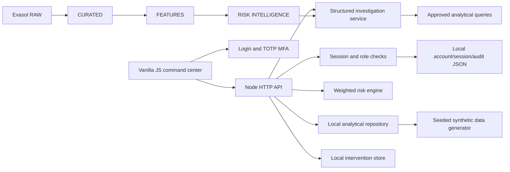

# Architecture

RuralLens separates the user interface, HTTP API, analytical domain services, and data repository. Local mode generates a deterministic relational-style portfolio in memory and stores interventions in `data/generated/interventions.json`. No Exasol or LLM credential is needed to run the demo.

`backend/domain.mjs` owns score components, tiers, seasonality-aware generated metrics, investigation evidence and scenario recomputation. `backend/server.mjs` validates requests and exposes API routes. Production Exasol SQL examples live in `sql/`; the local demonstration remains independent of those credentials. The LLM settings are reserved integration points; the current investigation path is deterministic and always uses generated analytical records.

`backend/security.mjs` implements first-admin bootstrap, scrypt password hashes, RFC 6238 TOTP challenges, HttpOnly SameSite session cookies, inactivity expiry, login/MFA rate limiting, account management, role checks, and audit events. Local JSON account/session/audit files are ignored by Git. The first-admin setup token appears in the server terminal only when no account exists (or is configured as an environment secret). Production use requires HTTPS, a durable protected identity store, and organization-approved operational policies.

Dashboard product summaries are grouped from the one generated loan record per borrower. Overdue buckets use each generated loan's highest repayment DPD as an explicitly documented demonstration proxy. The 36-month line is synthetic seeded history with a small shared portfolio cycle; it is not real-world history. NPA provisioning is unavailable until classifications, secured exposure inputs, existing balances, and institution-approved rules are supplied.

Human review language is shown in the product. The system does not approve, reject, restructure loans, assert fraud, or contact borrowers.

## Portfolio provisioning and recovery extension

See [Provisioning and recovery](PROVISIONING_RECOVERY.md) for the integrated services, persistent stores, classification and calculation semantics, API routes and regulatory scope.
