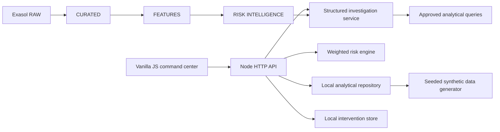

# Architecture

RuralLens separates the user interface, HTTP API, analytical domain services, and data repository. Local mode generates a deterministic relational-style portfolio in memory and stores interventions in `data/generated/interventions.json`. No Exasol or LLM credential is needed to run the demo.

`backend/domain.mjs` owns score components, tiers, seasonality-aware generated metrics, investigation evidence and scenario recomputation. `backend/server.mjs` validates requests and exposes API routes. Production Exasol SQL examples live in `sql/`; the local demonstration remains independent of those credentials. The LLM settings are reserved integration points; the current investigation path is deterministic and always uses generated analytical records.

Human review language is shown in the product. The system does not approve, reject, restructure loans, assert fraud, or contact borrowers.
